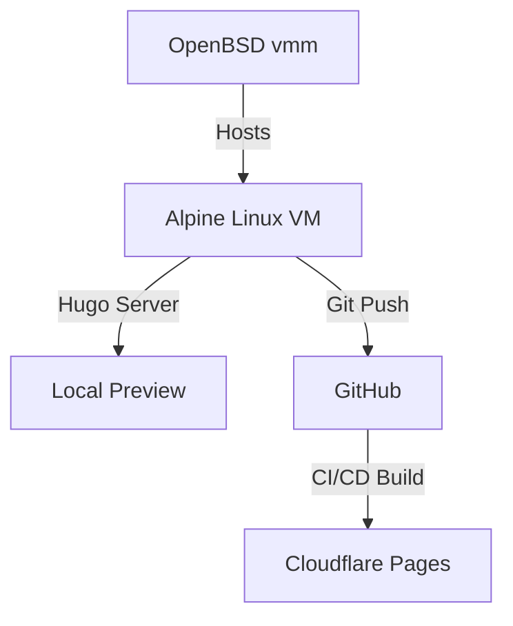

+++
date = '2026-10-18T15:33:38Z'
draft = false
title = 'From Alpine Linux'
+++

This post was created on a Alpine Linux VM running in OpenBSD VMM.  I had to make some modes.:wq

This is after a purge of unneeded npm modules.  Does this show?

### HI

